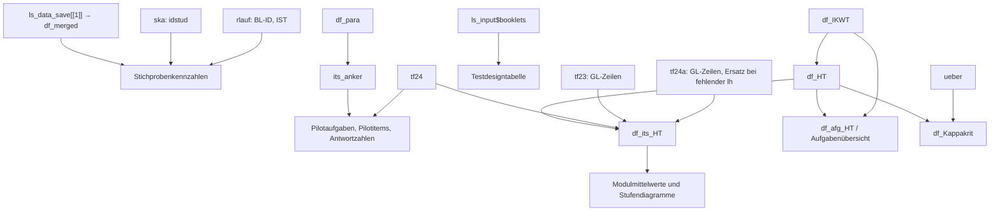

# Eingabeschnittstellen des technischen Berichts

Stand: 08.09.2026. Bezugsimplementierung: [TechRep_02.qmd](../TechRep_02.qmd).
Diese Dokumentation beschreibt den vorhandenen Code; sie führt kein neues
Dateiformat und keine automatische Validierung ein. Sie gilt unabhängig davon,
ob anschließend DOCX oder HTML ausgegeben wird.

## 1. Status und Verbindlichkeit

Im Repository gibt es keine zentrale Schema-/Klassendefinition, keinen
versionierten Datenvertrag und keine gemeinsame Eingabevalidierung für den
vollständigen Bericht. Die Schnittstellen ergeben sich aus den Importen und
den nachfolgenden R-Zugriffen. Die README bietet eine Übersicht; dieses Dokument
beschreibt die einzelnen Felder und die Beziehungen zwischen den Objekten.

Die zehn externen Originaldateien wurden nicht eingesehen. Deshalb wird zwischen
drei Arten von Aussagen unterschieden:

- **Codeanforderung:** direkt aus `TechRep_02.qmd` ablesbarer Name, Zugriff,
  Auswahl, Umkodierung oder Berechnung.
- **Datenbedingung:** Voraussetzung für fachlich konsistente Ergebnisse,
  beispielsweise eindeutige IDs. Der Code prüft diese häufig nicht.
- **Paketbefund:** ergänzende Information aus der lokal installierten Version;
  kein Nachweis über den Inhalt der historischen Originaldateien.

Die unten genannten Datentypen beschreiben eine geeignete Übergabe an den
Bericht. Sie sind keine vom Repository erzwungenen Typdeklarationen.
R-Namen und Schreibweisen sind grundsätzlich exakt einzuhalten.

## 2. Einstieg, Dateien und Einstellungen

Alle Importe stehen im Setup-Block, [Zeilen 37–137](../TechRep_02.qmd#L37).
Es gibt keine Funktion wie `render_report(data)` und keine Quarto-`params` für
die Datenquellen. Pfade und Einstellungen stehen unmittelbar im Dokument.

| Einstellung | Aktueller Wert / Bedeutung |
| --- | --- |
| `year` | Numerischer Skalar `2025`, Jahr der Hauptstudie; Pilotierungsjahr in vielen Texten `year - 1`. |
| `kb1`, `kb1_short` | `Größen und Messen`, `GM`. |
| `kb2`, `kb2_short` | `Daten, Häufigkeit und Wahrscheinlichkeit`, `DH`. |
| `versanddienst` | `Polyprint GmbH`; Textbausteine zur Durchführung. |
| `pt_ausw` | `R:/VERA3/Mathematik/V3_Ma_2025/1_Pilotierung 2024/12_Auswertung`. |
| `pt_ikw` | `R:/VERA3/Mathematik/V3_Ma_2025/2_Hauptstudie 2025/06_Itemkennwertetabelle/2 Finalabgabe`. |

Die Dateinamen und der YAML-Titel werden nicht aus `year` erzeugt.
Vorjahres-, Rücklauf- und Kodierdateien haben zusätzliche absolute Pfade.

| Nr. | Datei bzw. Pfad relativ zur angegebenen Basis | Import → Objekt |
| --- | --- | --- |
| 1 | `pt_ausw/1_Daten/V3-MA-2025_Pilot2024_Daten_2024-09-03.Rdata` | `load()` → `ls_data_save`, danach fünf Einzelobjekte |
| 2 | `pt_ausw/3_Skalierung/GL/GL_persons.csv` | `readr::read_csv2()` → `ska` |
| 3 | `pt_ausw/4_Ergebnisse/V3-MA-2025_Pilot2024_transformToBistaResults_2024-09-05.rds` | `readRDS()` → `tf24` |
| 4 | `pt_ausw/4_Ergebnisse/V3-MA-2025_Pilot2024_transformToBistaResults_KA3a_2024-09-05.rds` | `readRDS()` → `tf24a` |
| 5 | `R:/VERA3/Mathematik/V3_Ma_2024/01_Pilotierung_2023/11_Auswertung/4_Ergebnisse/V3-MA-2024_Pilot2023_transformToBistaResults_2023-08-31.rds` | `readRDS()` → `tf23` |
| 6 | `pt_ausw/4_Ergebnisse/V3-MA-2025_Pilot2024_Itemparameter_2024-09-05.xlsx` | `readxl::read_excel(sheet = "Items")` → `df_para` |
| 7 | `pt_ausw/2_Inputliste/V3-MA-2025-Pilot24_Inputliste_aus_R_240903.xlsx` | `eatPrep::readDaemonXlsx()` → `ls_input` |
| 8 | `pt_ikw/Itemparameter VERA3-Mathematik-2025 Ma Modularisierung.csv` | `read.csv2(encoding = "latin1", stringsAsFactors = FALSE)` → `df_IKWT` |
| 9 | `R:/VERA3/Mathematik/V3_Ma_2025/1_Pilotierung 2024/10_Durchführung/Rücklauf/MA_VERA-3_Pilo2024_Rücklauf_100%_aus_Scanmanager.xlsx` | `readxl::read_xlsx(sheet = 1, range = "A4:G189")` → `rlauf` |
| 10 | `R:/VERA3/Mathematik/V3_Ma_2025/1_Pilotierung 2024/04_Kodierung/KA3-Kodierung/6_Hauptkodierung/3_Auswertung/V3-MA-2025_Pilo2024_Hauptkodierung_uebereinstimmung.xlsx` | `readxl::read_xlsx(sheet = "Übereinstimmung_gesamt")` → `ueber` |

Beide CSV-Leser verwenden Semikolon als Feldtrenner und Dezimalkomma.
Nur bei Nr. 8 wird explizit Latin-1 angegeben. Bei Nr. 2 ist kein eigener
Zeichensatz und bei beiden CSV-Dateien kein explizites Spaltenschema festgelegt.
Die Excel-Importe Nr. 6, 9 und 10 verwenden ebenfalls automatische Typbestimmung.
IDs sollten als Text importiert werden: Eine nachträgliche Umwandlung numerisch
eingelesener IDs stellt verlorene führende Nullen nicht wieder her.

## 3. `ls_data_save` und `df_merged`: Personendaten

Quelle: [Setup ab Zeile 60](../TechRep_02.qmd#L60),
[Stichprobenberechnungen ab Zeile 398](../TechRep_02.qmd#L398).

### Container

Die RData-Datei muss ein Objekt mit dem Namen `ls_data_save` bereitstellen.
Der Code erwartet eine Liste mit mindestens fünf Elementen und greift nach
Position zu, unabhängig von deren Namen:

| Position | Zielobjekt | Verwendung nach dem Laden |
| --- | --- | --- |
| `[[1]]` | `df_merged` | Personentabelle für Stichprobenkennzahlen. |
| `[[2]]` | `df_recoded` | Im Bericht nicht weiter verwendet. |
| `[[3]]` | `df_aggregated` | Im Bericht nicht weiter verwendet. |
| `[[4]]` | `df_scored` | Im Bericht nicht weiter verwendet. |
| `[[5]]` | `df_mcoll` | Im Bericht nicht weiter verwendet. |

Für Positionen 2–5 ist aus dem Bericht kein inneres Schema ableitbar.
Sie müssen im aktuellen Importcode als Listenpositionen vorhanden sein;
ihre Inhalte werden nicht ausgewertet. Nach der Zuweisung wird `ls_data_save`
aus der Ausführungsumgebung entfernt. `load()` lädt gegebenenfalls auch weitere
in der RData-Datei gespeicherte Objekte; die Datei sollte keine Namenskollisionen
mit dem Setup verursachen.

### Felder von `df_merged`

Eine Zeile soll einer Person entsprechen. Geeignete Klasse: `data.frame`
oder kompatibler Tibble.

| Spalte | Geeigneter Typ | Bedeutung und Codeverhalten |
| --- | --- | --- |
| `idstud` | `character` | Personen-ID; Verbindung mit `ska$idstud`. Erste zwei Zeichen = Bundeslandcode, erste acht = Klassen-ID. |
| `ADaten_Alter` | `numeric` oder sauber numerisch konvertierbarer Text | Alter in Jahren. Wird mit `as.numeric()` umgewandelt; für Mittelwert und SD werden nur Werte `< 90` berücksichtigt. |
| `ADaten_BedingVeraendert` | `character` mit `"0"`, `"1"` | `0` normale, `1` veränderte Testbedingungen. Weitere Werte werden nicht in diese zwei Kategorien umkodiert. |
| `ADaten_Geschlecht` | `character` | `1` männlich, `2` weiblich, `3` divers; für die Gesamtstatistik werden alle anderen Werte einschließlich `NA` nach `4` = keine gültige Angabe umkodiert. |
| `ADaten_Sprache` | `character` | `1` immer Deutsch, `2` Deutsch und andere Sprache, `3` meistens andere Sprache; in der Gesamtstatistik werden andere Werte einschließlich `NA` nach `4` = keine gültige Angabe umkodiert. |

**Datenbedingungen und Einschränkungen:**

- `idstud` soll eindeutig und nicht fehlend sein. `semi_join(ska)` filtert
  Personen, entfernt aber keine Dubletten aus `df_merged`.
- Alter nicht als Faktor übergeben: `as.numeric(factor)` würde Faktorcodes
  liefern. Nichtnumerischer Text wird `NA`; diese Fälle sowie Alter ab 90
  entfallen durch den Filter. Eine fachliche Untergrenze prüft der Code nicht.
- Häufigkeitstabellen werden nicht auf alle Kategorien aufgefüllt. Fehlt etwa
  Kategorie `1` bei den Testbedingungen oder eine im Text abgefragte
  Geschlechtskategorie vollständig, liefert der entsprechende Zugriff keinen
  Prozentwert statt automatisch `0 %`.
- Die Sprachstatistik nach Bundesland nutzt separat die ursprünglichen Werte
  mit `ADaten_Sprache <= 5`; dort erfolgt die Umkodierung der Gesamtstatistik
  nicht. Die drei benannten Sprachkategorien müssen für die späteren
  Spaltenzugriffe insgesamt vorhanden sein. Fehlende Kategorien innerhalb
  einzelner Länder erzeugen `NA` statt automatisch 0; die Nenner können sich
  von denen der Gesamtstatistik unterscheiden.
- Die Klassen `21013001` und `22013101` werden ausdrücklich Niedersachsen
  zugeordnet. Das ist ein bestehender Hotfix, kein allgemeines ID-Schema.

## 4. `ska`: ausgewertete Personen

Quelle: [Zeile 70](../TechRep_02.qmd#L70).
Tabelle mit einer Zeile je in die Skalierung einbezogener Person.
Einzige im Bericht verwendete Spalte: `idstud`, nach dem Import explizit
in `character` umgewandelt. Weitere Skalierungswerte werden hier nicht genutzt.

`nrow(ska)` wird als gesamte Teilnehmerzahl ausgegeben. Für die übrigen
Personenstatistiken wird dagegen `df_merged |> semi_join(ska, by = "idstud")`
verwendet. Deshalb sollen `ska$idstud` eindeutig, vollständig und vollständig
in `df_merged$idstud` enthalten sein. Andernfalls können die Angaben im Bericht
auseinanderlaufen, ohne dass der Import fehlschlägt.

## 5. `tf24`, `tf24a`, `tf23`: gespeicherte Itemkennwerte

Quelle: [Zeilen 74–124](../TechRep_02.qmd#L74),
[Itemzählung](../TechRep_02.qmd#L300),
[Antwortzahlen](../TechRep_02.qmd#L452),
[Kompetenzstufenvergleich](../TechRep_02.qmd#L639).

### Container und tatsächlich benötigte Komponenten

| Objekt | Erforderliche Komponenten | Zweck |
| --- | --- | --- |
| `tf24` | `$itemparsVera`, `$itempars` | Pilotierung 2024; Itemzahlen, Antwortzahlen, Kompetenzstufenvergleich und Haupttestkennwerte. |
| `tf24a` | `$itemparsVera` | Ergänzung fehlender Haupttestkennwerte aus dem KA3a-Modell. |
| `tf23` | `$itemparsVera` | Kennwerte der wiederverwendeten Items aus der Pilotierung 2023. |

Erwartet werden Listen mit Tabellen unter diesen Namen. Eine besondere
S3-Klasse wird im Bericht nicht geprüft oder benötigt. Weitere Komponenten
wie Personenparameter oder Referenzpopulation werden nicht gelesen.

### `$itemparsVera`

Erwartet wird eine lange Tabelle: eine Zeile je Kombination aus Item und
Domäne. Ein Item kann mehrere Zeilen haben, beispielsweise eine für `GL`
und eine für `GM`.

| Spalte | Geeigneter Typ | Bedeutung / Verwendung |
| --- | --- | --- |
| `iqbitem_id` | `character` | Item-ID, verbindet Kennwerte, Analysetabelle und Haupttestauswahl. |
| `domain` | `character` | Domäne. `GL` = Globalmodell; für die zwei Leitideen `GM`, `DH`. `DHW` wird in allen drei Objekten nach `DH` umbenannt. |
| `lh` | `numeric`, Anteil 0–1 | Lösungshäufigkeit. Modulmittelwerte werden mit 100 multipliziert. `NA` steuert den KA3a-Ersatz. |
| `logit` | `numeric`, endlich | Vorhandene Itemschwierigkeit in Logits; wird für die Modulmittelwerte verwendet. |
| `kstufe` | `integer`/`numeric`, Werte 1–5 | Vorhandene Kompetenzstufe. Der Code subtrahiert Stufen und wandelt sie erst für die Grafik in römische Zahlen um. Texte wie `"III"` oder Stufen `"1a"` passen nicht zu dieser Verarbeitung. |

**Die Spaltenpositionen sind zusätzlich relevant:** In der Zusammenführung
verwendet der Code `itemparsVera[1:8]`. Alle drei Tabellen brauchen daher
mindestens acht Spalten. Die fünf oben genannten Felder müssen innerhalb
dieser ersten acht Spalten liegen. Die drei Ausschnitte müssen kompatible
Spaltennamen und Typen für `rbind()` haben. Für Datenrahmen kann `rbind()` nach
Namen ausrichten; entscheidend ist vor allem die Auswahl der ersten acht
Spalten. Zusätzliche benötigte Felder an Position 9 oder später würden entfallen.

Die genaue historische Reihenfolge der Original-RDS-Dateien ist unbekannt.
Als **Paketbefund** ergibt sich aus `eatModel` 0.10.39 für den einfachen langen
Fall mit einer Lösungshäufigkeitsspalte folgende typische Reihenfolge:

```r
c("domain", "iqbitem_id", "lh", "trennschaerfe",
  "logit", "infit", "bista", "kstufe")
```

`trennschaerfe`, `infit` und `bista` werden im vorliegenden Bericht nicht direkt
ausgewertet. Sie sind in dieser typischen Struktur die übrigen drei Spalten,
keine durch den Bericht ausdrücklich geforderten Feldnamen.

**Datenbedingungen:**

- `(iqbitem_id, domain)` soll innerhalb einer Tabelle eindeutig sein.
  Andernfalls entstehen beim Kompetenzstufenvergleich Listen-Spalten oder
  bei Joins zusätzliche Zeilen und damit falsche Zählungen/Mittelwerte.
- Für `tf24` werden `GL`, `GM` und `DH` nach der Umbenennung erwartet. Für den
  Vergleich braucht jedes berücksichtigte Leitideenitem zusätzlich einen
  gültigen globalen Stufenwert. Die Menge der Leitideenitems muss nicht leer sein.
- Die Basismodulzahl wird als `n(GL) - n(GM) - n(DH)` berechnet. Das setzt eine
  dazu passende, nicht überlappende Zuordnung der beiden Leitideenpools voraus.
- Für `tf23` und `tf24a` nutzt die Kennwertzusammenführung nur `GL`-Zeilen.
- Die vereinigten `GL`-Zeilen aus `tf24` und `tf23` sollen je `iqbitem_id`
  eindeutig sein. Es gibt keine Vorrangregel „neueres Jahr gewinnt“.
- `lh` und `logit` dürfen nach der Zusammenführung für ausgewählte Items nicht
  fehlen, wenn vollständige Mittelwerte erwartet werden: `mean()` verwendet
  hier kein `na.rm = TRUE`.

### `$itempars` nur in `tf24`

| Spalte | Geeigneter Typ | Verwendung |
| --- | --- | --- |
| `item` | `character` | Item-ID, abgeglichen mit `its_anker` aus `df_para$iqbitem_id`. |
| `Nvalid` | `numeric`, nichtnegative ganzzahlige Werte | Anzahl gültiger Antworten; Minimum, Median und Maximum getrennt für Pilot- und Ankeritems. |

Es wird weder nach Modell noch nach Domäne gefiltert und auch nicht
dedupliziert. Der Inhalt dieser Komponente bestimmt deshalb unmittelbar,
welche Zeilen in die Antwortstatistik eingehen. Ob die Originaldatei mehrere
Modellzeilen je Item enthält, muss an den Originaldaten geprüft werden.
Beide Gruppen sollten gültige Antwortzahlen enthalten.

### Was `eatModel` zusätzlich dokumentiert

Die lokal installierte Hilfe `help("transformToBista", package = "eatModel")`
beschreibt die vorgelagerte Transformation und das Ergebnis als Liste mehrerer
Tabellen. Die lokale Implementierung gibt die Klasse `c("transfBista", "list")`
zurück, unter anderem mit `itempars` und `itemparsVera`.

Das ist kein garantiert passender Exportvertrag für diesen Bericht:
`itemparsVera` kann je nach Optionen fehlen, und die interne Funktion
`createItemVeraObj()` kann unter bestimmten Datenkonstellationen eine breite
Tabelle mit etwa `GL_logit`/`domain_logit` erzeugen. Diese breite Form ist mit
dem hier erwarteten langen Schema nicht kompatibel. Auch mehrere
Lösungshäufigkeitsspalten können die ersten acht Spalten verändern.
Der Bericht selbst ruft `transformToBista()` nicht auf.

## 6. `df_para`: Analyse- und Ankertabelle

Quelle: [Zeilen 86–91](../TechRep_02.qmd#L86),
[Aufgabenzählung](../TechRep_02.qmd#L290).
Excel-Blatt exakt `Items`; geeignete Struktur: Tabelle mit Item-/Aufgabenzuordnungen.

| Spalte | Geeigneter Typ | Verwendung |
| --- | --- | --- |
| `Modul` | `character` | Enthält der Text die groß-/kleinschreibungssensitive Zeichenfolge `Link`, wird das Item als Anker identifiziert. |
| `iqbitem_id` | `character` | Item-ID; daraus wird die eindeutige Menge `its_anker` gebildet. |
| `AufgID` | `character` | Aufgaben-ID; eindeutige Aufgaben nach Ausschluss sämtlicher Anker-IDs werden gezählt. |

Ein Item gilt überall als Anker, sobald mindestens eine seiner Tabellenzeilen
`Link` im Modulnamen enthält. Mehrere Zeilen pro Item können daher vorkommen.
Fehlende `AufgID` werden von `unique() |> length()` als eigener Wert mitgezählt;
IDs sollten vollständig sein. Fehlendes `Modul` identifiziert keinen Anker.

## 7. `ls_input$booklets`: Testheftdesign

Quelle: [Import](../TechRep_02.qmd#L94),
[Tabellenerzeugung](../TechRep_02.qmd#L319).

Das Excel-Blatt muss `booklets` heißen. Eine Zeile repräsentiert ein Testheft.
Für die unveränderte Tabelle werden genau diese Spalten in dieser Reihenfolge
erwartet:

```r
c("booklet", "block1", "block2", "block3", "block4",
  "block5", "block6", "block7")
```

| Spalte | Typ nach lokalem Import | Verwendung |
| --- | --- | --- |
| `booklet` | `character` | Testheftbezeichnung, zum Beispiel `TH01`. |
| `block1` | `character` | Wird entfernt; muss wegen `select(-block1)` dennoch existieren. |
| `block2` bis `block6` | `character` | Fünf Basisblöcke, in der Ausgabe mit `ZO`, `GM`, `DH`, `MS`, `RF` überschrieben. |
| `block7` | `character` | Ergänzungsblock; Ausgabeüberschrift `GM/DH`. |

`_Stopp` wird aus allen Texten entfernt. Texte mit `Link` werden mit Markdown-
Sternchen umgeben. Nach `block6` wird eine zusätzliche Spalte `Pause`
eingefügt. Anschließend hängt `rbind()` zwei fest definierte Beschriftungszeilen
an. Zusätzliche Excel-Spalten passen nicht zu diesen Zeilen; abweichende
Reihenfolgen können die festen Überschriften falsch zuordnen.

Die Berichtserzählung nennt fest 24 Testhefte und bestimmte Blockzahlen.
Diese Zahlen werden nicht aus `nrow(ls_input$booklets)` bestimmt.

**Paketbefund `eatPrep` 1.0.11:** Der Import liest Blattwerte mit
`col_types = "text"`, behandelt leere Zellen als fehlend und gibt eine Liste
von Datenrahmen zurück. Er versucht folgende Blätter zu lesen:
`units`, `subunits`, `values`, `unitrecoding`, `sav-files`, `params`,
`aggregate-missings`, `booklets`, `blocks`.
Fehlende Blätter werden per Meldung übersprungen; für diesen Bericht wird
anschließend nur `$booklets` verwendet. Ein Workbook nur mit passendem
`booklets`-Blatt kann damit für diese Berichtsstufe genügen, wäre aber keine
vollständige Eingabe für die vorgelagerte Datenaufbereitung.

Die Hilfe `help("readDaemonXlsx", package = "eatPrep")` beschreibt den
ZKDaemon-/IQB-Ursprung und eine Liste von Datenrahmen als Rückgabe. Sie nennt
zusätzlich `itemproperties` und `propertylabels`, die die geprüfte lokale
Implementierung nicht einliest. Hilfe und Implementierung sind hier also
nicht vollständig deckungsgleich. Der Import prüft für `booklets` nur
`booklet` und `block1` per Meldung; die Berichtsvorlage verlangt mehr.

## 8. `df_IKWT`: Haupttestauswahl und Aufgabenreihenfolge

Quelle: [Zeilen 97–130](../TechRep_02.qmd#L97),
[Aufgabentabelle ab Zeile 873](../TechRep_02.qmd#L873).
Tabelle mit Itemkennwert-Zeilen je Modell und Modul; `iqbitem_id` allein
ist hier ausdrücklich kein generell eindeutiger Zeilenschlüssel.

| Spalte | Geeigneter Typ | Bedeutung / Verwendung |
| --- | --- | --- |
| `iqbitem_id` | `character` | Item-ID. Zeilen mit echtem `NA` werden unmittelbar entfernt; leere Zeichenketten werden nicht ausdrücklich herausgefiltert. |
| `model` | `character` | Erwartete Auswahlwerte: `global`, `gm`, `dh`. Steuert Auswahl und Gruppierung der Haupttestitems. |
| `domain` | `character` | Muss vorhanden sein, weil sie nach `df_HT` übernommen wird; für die Grafikdomäne wird später stattdessen `model` verwendet. |
| `iqbmodul_id` | `character` | Vollständige Modul-ID. Der Code verwirft die ersten neun Zeichen und erwartet danach `GL-BM`, `GM-EM-A`, `GM-EM-B`, `DH-EM-A` oder `DH-EM-B`. |
| `itemnr_mod` | `numeric` oder sauber numerisch konvertierbarer Text | Aufgabenposition im Modul. Wird erst mit `as.numeric()` konvertiert, dann gerundet. Teilitems derselben Aufgabe sollen zur gleichen Position passen. |
| `name` | `character` | Aufgabenname; erscheint in der Aufgabenübersicht. |

Ein syntaktisch passendes, frei erfundenes Modul-ID-Beispiel ist
`V3MA2025-GL-BM`: `V3MA2025-` hat neun Zeichen. Der Code prüft den Präfixinhalt
nicht; daraus folgt keine Aussage über die historischen Originalpräfixe.

### Auswahlregel und Join-Verhalten

1. `df_HT` behält Zeilen mit `model == "global"` und Modul-Endung `BM` sowie
   **alle** Zeilen mit `model != "global"`.
2. Damit werden globale Ergänzungsmodulzeilen verworfen. Nichtglobale
   Basismodulzeilen würden hingegen ebenfalls übernommen; der Kommentar
   „für BM nur global“ ist durch die Bedingung nicht vollständig abgesichert.
3. `df_its_HT` übernimmt `domain = model` und `lbl = str_sub(iqbmodul_id, 10)`.
   Die Itemkennwerte werden für sämtliche Module aus den `GL`-Zeilen von
   `tf24` und `tf23` ergänzt, verbunden ausschließlich über `iqbitem_id`.
4. Zeilen mit fehlender `lh` werden erneut aus `tf24a` ergänzt. Nur fehlende
   `logit` oder `kstufe` lösen diesen Ersatz nicht aus. Auch nach dem Ersatz
   fehlende Kennwerte werden nicht abschließend validiert.

Für die Grafiken werden `global`, `gm`, `dh` exakt kleingeschrieben verglichen.
Dass die Zählung an anderer Stelle `str_to_upper()` verwendet, macht die
Schnittstelle insgesamt nicht unabhängig von Groß-/Kleinschreibung.

**Datenbedingungen:**

- Nach Auswahl sollte jede Kombination aus Item und vorgesehenem Modul nur
  einmal vorkommen. `n_its_ht` zählt Zeilen, nicht eindeutige Item-IDs.
  Ein Item in zwei Modulen zählt somit zweimal.
- Die Aufgabenübersicht verbindet `df_IKWT` und `df_HT` nur über `iqbitem_id`,
  nicht zusätzlich über Modul und Position. Mehrfachverwendungen eines Items
  mit unterschiedlichen Positionen können dadurch falsche Zuordnungen erzeugen.
- Nach dieser Verbindung muss je `(itemnr_mod, iqbmodul_id)` ein eindeutiger
  Aufgabenname übrig bleiben. Sonst kann `pivot_wider()` Listen-Spalten erzeugen.
- Aufgaben werden in `df_afg_HT` anhand eindeutiger Paare aus `name` und Modul
  gezählt. Verschiedene Aufgaben gleichen Namens werden dort zusammengefasst.
- Die Ausgabe ist auf fünf Module zugeschnitten. Insbesondere `GL-BM` sowie
  beide `GM`-Ergänzungsmodule werden direkt nach Namen angesprochen; auch die
  Tabellenbreiten und Texte setzen die vollständige Modulstruktur voraus.

## 9. `rlauf`: Klassenrücklauf

Quelle: [Import](../TechRep_02.qmd#L134),
[Klassenstatistik](../TechRep_02.qmd#L402).
Eine Zeile soll eine angefragte Klasse darstellen.

| Spalte | Geeigneter Typ | Bedeutung / Verwendung |
| --- | --- | --- |
| `BL-ID` | `character` | Bundeslandcode, verbunden mit der Textspalte `BuLa$BL`. Ein numerischer Excel-Import kann beim Join einen Typfehler verursachen. |
| `IST` | `numeric`, nichtnegativ | Nur das Kriterium `IST > 0` wird ausgewertet; eine solche Zeile zählt als eine realisierte Klasse. |

Der Bereich `A4:G189` ist fest. Mit den Import-Defaults wird Zeile 4 als
Spaltenkopf gelesen; die Daten müssen in dem darunterliegenden Bereich liegen.
Die übrigen fünf Spalten werden nicht verwendet. `IST` wird nicht zur
Teilnehmerzahl aufsummiert; diese stammt aus `nrow(ska)`.

Jede eingelesene Zeile zählt als angefragt, auch bei fehlendem `IST`.
Fehlende Werte sind deshalb kein Ersatz für das Entfernen leerer/ungültiger
Klassenzeilen. Länder ohne positive `IST`-Zeile fehlen in `rlauf_IST` und
erhalten nach dem Join `NA` statt automatisch null realisierte Klassen.

Die eingebauten Codes sind:

| Code | Land | Code | Land |
| --- | --- | --- | --- |
| 11 | Baden-Württemberg | 19 | Niedersachsen |
| 12 | Bayern | 20 | Nordrhein-Westfalen |
| 13 | Berlin | 21 | Rheinland-Pfalz |
| 14 | Brandenburg | 22 | Saarland |
| 15 | Bremen | 23 | Sachsen |
| 16 | Hamburg | 24 | Sachsen-Anhalt |
| 17 | Hessen | 25 | Schleswig-Holstein |
| 18 | Mecklenburg-Vorpommern | 26 | Thüringen |

`71` wird ausdrücklich auf `NA` abgebildet; unbekannte Codes finden ebenfalls
kein Land. Die Länderzahl im Text verwendet `zahlwort[nrow(rlauf_SOLL)]` mit
nur zwölf Zahlwörtern. Mehr als zwölf Länder sind damit textlich nicht abgedeckt.

## 10. `ueber`: Kodierübereinstimmung

Quelle: [Import](../TechRep_02.qmd#L137),
[Auswertung ab Zeile 562](../TechRep_02.qmd#L562).
Eine Zeile soll eine auszuwertende Kodier-Variable mit ihren Kennwerten darstellen.

| Spalte | Geeigneter Typ | Bedeutung / Verwendung |
| --- | --- | --- |
| `Variable` | `character` | Der Code entfernt exakt das letzte Zeichen, um `iqbitem_id` zu erhalten. Beispielsweise wird aus dem synthetischen `demo_01a` die ID `demo_01`. |
| `meankappa` | `numeric` | Bereits berechnetes Kappa. Haupttestvariablen mit `round(meankappa, 2) < 0.8` werden als Ausnahmen genannt. |
| `meanagree` | `numeric`, Anteil 0–1 | Bereits berechnete Übereinstimmung; der Median wird zur Ausgabe mit 100 multipliziert. |

Der Bericht berechnet die Übereinstimmung nicht aus zwei Kodierungen neu.
Die Ausnahmezählung nutzt per `semi_join(df_HT)` nur Haupttestitems;
die beiden Gesamtmediane nutzen dagegen **alle Zeilen von `ueber`**.
Bei fehlenden Werten werden die Mediane `NA`, da `na.rm` nicht gesetzt wird.
Mehrere Zeilen für dieselbe Item-ID werden bei der Ausnahmezählung nicht
zusammengefasst. Mehr als zwölf Ausnahmen passen nicht zur Zahlwortliste.
Die Bedeutung des entfernten Suffixzeichens ist im Repo nicht dokumentiert.

## 11. Beziehungen und intern abgeleitete Objekte



`df_HT`, `df_its_HT`, `df_afg_HT`, `its_anker`, `Tab_*`, `n_*` und `freq*`
sind interne Ergebnisse. Es sind keine zusätzlich anzuliefernden Dateien.

## 12. Strukturbeispiel und Prüfung eigener Daten

Dieses Beispiel zeigt nur die Form einer langen Itemtabelle mit acht Spalten.
Es ist synthetisch, enthält keine vollständige Studie und kann den gesamten
`TechRep_02.qmd` nicht allein versorgen:

```r
itemparsVera <- data.frame(
  domain = c("GL", "GM", "GL", "DH"),
  iqbitem_id = c("demo_01", "demo_01", "demo_02", "demo_02"),
  lh = c(0.75, 0.75, 0.40, 0.40),
  trennschaerfe = c(0.30, 0.30, 0.35, 0.35),
  logit = c(-0.7, -0.6, 0.7, 0.8),
  infit = c(1.01, 1.02, 0.99, 1.00),
  bista = c(475, 484, 603, 612),
  kstufe = c(3L, 3L, 5L, 5L),
  stringsAsFactors = FALSE
)

tf24 <- list(
  itemparsVera = itemparsVera,
  itempars = data.frame(
    item = c("demo_01", "demo_02"),
    Nvalid = c(100L, 120L)
  )
)
str(tf24)
```

Die zusätzliche lokale CSV-Demo `examples/items_minimal.csv` hat dagegen bewusst
nur fünf Spalten und ein Feld `modul`; sie gehört zum lokalen Arbeitsexperiment
`TechRep_minimal.qmd`, nicht zu `TechRep_02.qmd` oder zur neuen Paket-API.
Diese beiden Arbeitsdateien sind nicht Bestandteil des neuen Paketstands.

Zur Bestandsaufnahme einer eigenen RDS-Datei eignen sich:

```r
x <- readRDS("pfad/zur/datei.rds")
class(x)
names(x)
str(x, max.level = 2)
names(x$itemparsVera)
vapply(x$itemparsVera, function(z) paste(class(z), collapse = "/"), "")
table(x$itemparsVera$domain, useNA = "ifany")
anyDuplicated(x$itemparsVera[c("iqbitem_id", "domain")])
colSums(is.na(x$itemparsVera))
```

Vor einem vollständigen Renderlauf sollten insbesondere folgende Bedingungen
geprüft werden. Diese Liste dokumentiert Prüfbedarf; sie ist kein bereits
integrierter Validator:

1. Alle Dateien, Blattnamen, Spalten und Listenpositionen existieren.
2. IDs sind Text, vollständig und über die Tabellen hinweg kompatibel.
3. Personen-IDs und die vorgesehenen Item-/Domänen-Schlüssel sind eindeutig.
4. `ska` ist vollständig durch `df_merged` abgedeckt.
5. Ankerkennzeichnung und Aufgaben-IDs sind vollständig und konsistent.
6. Lange Itemtabellen enthalten die benötigten Felder in den ersten acht Spalten.
7. Die vereinigten globalen Kennwerte sind eindeutig; alle ausgewählten Items
   haben nach dem KA3a-Ersatz gültige `lh`, `logit` und `kstufe`.
8. Kategorien, Länder, Testhefte und Module passen zu den festen Zugriffen
   und den Aussagen im Berichtstext.
9. Aufgabenname und Position bleiben bei den Item-Joins eindeutig.
10. Fehlende Werte und Dubletten sind geprüft; Warnungen allein reichen nicht,
    da die Vorlage `warning: false` und `message: false` setzt.

## 13. Quellen, Versionsgrenzen und offene Punkte

Primäre Quelle ist der oben jeweils verlinkte Berichtscode. Für den Vergleich
wurden auch `TechRep_01.qmd` und das Minimalbeispiel gelesen. Die Dateinamen
01/02 kennzeichnen Berichtsfassungen, keine Schema-Versionen.

Zusätzlich geprüft wurden lokal:

- `eatPrep` **1.0.11**: Hilfe und Implementierung von `readDaemonXlsx()`.
- `eatModel` **0.10.39**: Hilfe und Implementierung von `transformToBista()`
  sowie die interne Hilfsfunktion `createItemVeraObj()`.

Die mitgelieferte `grateful-refs.bib` nennt ältere Versionen (`eatPrep` 1.0.3,
`eatModel` 0.8.34). Die lokalen Paketbefunde dürfen daher nicht ungeprüft als
Spezifikation der historischen Exporte behandelt werden. Die interne Funktion
`createItemVeraObj()` ist hier eine Untersuchungsquelle, keine empfohlene
öffentliche Importschnittstelle.

Offen bleiben ohne Originaldaten und deren Erzeugungsskripte insbesondere:

- die vollständigen Schemata der ungenutzten Aufbereitungsstufen 2–5;
- die tatsächlichen ersten acht Spalten und Klassen der historischen RDS-Dateien;
- die Modell-/Domänenabdeckung von `tf24$itempars` und damit die genaue
  Zeilenbasis der Antwortstatistiken;
- der verbindliche Aufbau der vollständigen IDs und des Kodiersuffixes;
- die tatsächlichen Fehlwertcodes, Dubletten und Ausprägungen in den Excel-/CSV-Dateien.

Diese Dokumentation wurde gegen die Zugriffe im Quellcode und die genannten
lokalen Paketimplementierungen abgeglichen. Eine Validierung der Originaldaten
oder ein erfolgreicher vollständiger Renderlauf ist damit nicht nachgewiesen.
